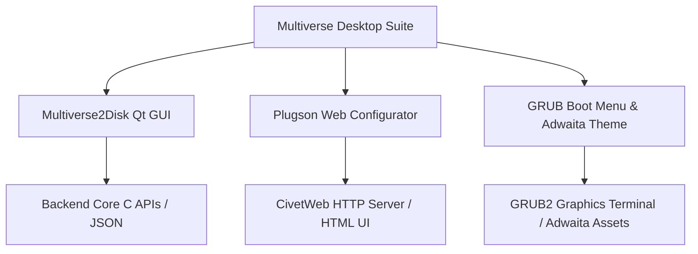

# Multiverse Desktop Apps Design Document

## 1. Overview & Objectives

The **Multiverse** desktop applications suite provides robust, user-friendly tools for creating bootable drives, managing disk partitions, configuring runtime plugins, and delivering a polished boot menu experience. This document outlines the architecture, UI/UX design system, and component design for the Multiverse desktop apps following the transition to the **Multiverse** brand and modern UI refresh.

---

## 2. Architecture & Components

### 2.1 Multiverse2Disk (Qt GUI)
* **Purpose**: Cross-platform installer application for writing Multiverse core files to USB drives, SSDs, and external storage.
* **Key Files**:
  * [`ventoy2diskwindow.ui`](file:///C:/Users/29bragann/StudioProjects/Multiverse/LinuxGUI/Ventoy2Disk/QT/ventoy2diskwindow.ui): XML layout defining device selection, local/device package versions, progress bar, and installation options.
  * [`ventoy2diskwindow.cpp`](file:///C:/Users/29bragann/StudioProjects/Multiverse/LinuxGUI/Ventoy2Disk/QT/ventoy2diskwindow.cpp): Main window controller handling installation threads, async progress updates, language selection, and modern QSS stylesheet injection.
  * [`Ventoy2Disk.rc`](file:///C:/Users/29bragann/StudioProjects/Multiverse/Ventoy2Disk/Ventoy2Disk/Ventoy2Disk.rc): Windows resource script for metadata, version info, dialogs, and executable branding.

### 2.2 Plugson (Web-Based Plugin Configurator)
* **Purpose**: Local web server providing an administrative graphical interface for configuring Multiverse plugins (`ventoy.json`, auto-installation, persistence, themes, passwords).
* **Key Technologies**: Embedded CivetWeb HTTP server (`src/Web/ventoy_http.c`), AdminLTE / Bootstrap frontend (`www/`).

### 2.3 GRUB Boot Menu & Adwaita Theme
* **Purpose**: Provides the interactive boot loader interface when booting from the Multiverse drive.
* **Key Files**:
  * `INSTALL/grub/themes/ventoy/theme.txt`: GRUB theme configuration utilizing the newly integrated `ventoy-adwaita` theme assets (`background.png`, `1024x768.png`, window frames, sliders, and progress bars).
  * `INSTALL/grub/menu/en_US.json`: Localization strings defining utility menus (`Multiverse UEFI Utilities`), plugin checks, and boot options.

---

## 3. UI/UX Design System & Branding

### 3.1 Design Principles
* **Modern & Clean**: Replaced legacy Win32/Classic Qt aesthetics with a sleek flat-design system featuring rounded borders, subtle container cards, and professional padding.
* **Consistent Branding**: Complete removal of legacy brand names in favor of **Multiverse** across window titles, executables, installers, boot titles, and documentation.

### 3.2 Color Palette & Typography
* **Primary Accent**: `#2563eb` (Vibrant Blue for primary buttons, selection highlights, and progress bars).
* **Surface Background**: `#f8fafc` (Soft light neutral for application background) and `#ffffff` (Card containers).
* **Text & Borders**: `#334155` (Slate dark for headings), `#1e293b` (Primary text), and `#cbd5e1` (Subtle container borders).
* **Typography**: Clean sans-serif font stack (Segoe UI, Inter, system-ui) with clear visual hierarchy (bold group box titles, 20pt emphasized version readouts).

---

## 4. Verification & Testing Plan

### 4.1 Automated & Manual Validation
* **Qt UI Render Test**: Compile and launch `Multiverse2Disk` on Linux/Windows to verify stylesheet rendering, device enumeration, and button interactions.
* **Boot Menu Validation**: Verify GRUB rendering with the new `ventoy-adwaita` theme and `"Multiverse"` title text in UEFI/Legacy virtual machine boot test environments.
* **Configurator Test**: Launch Plugson to confirm web UI assets load correctly under the Multiverse brand.
